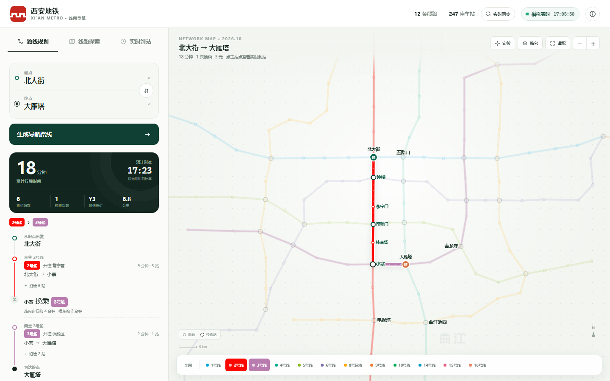
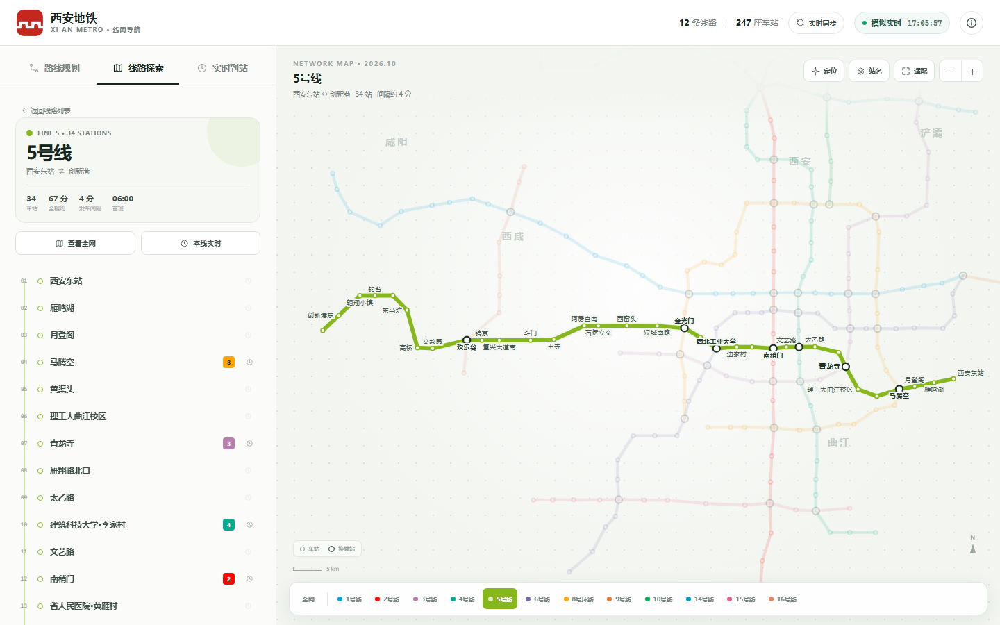
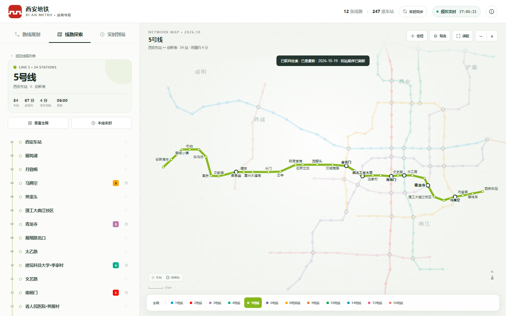
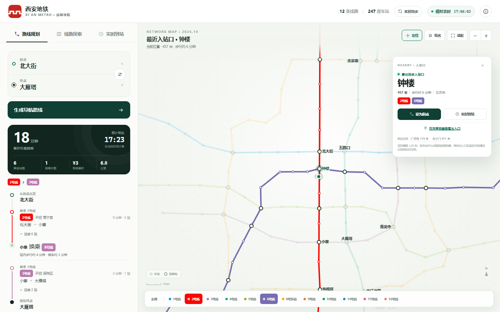

# 西安地铁 · 线网导航

一款以单文件离线使用为主的西安地铁导航应用。直接双击 `index.html` 即可使用；需要联网同步官方线路与站序时，运行同目录的轻量同步服务。



## 功能

- **路线规划**：输入起点与终点，自动生成「最快」与「少换乘」方案，估算用时、乘坐站数、换乘次数、里程与票价。
- **线网地图**：展示 1、2、3、4、5、6、8、9、10、14、15、16 号线全部 247 座车站；支持缩放、拖拽、站名开关。
- **单线探索**：点击地图线路直接进入线路详情并高亮整条线路；底部线路条和线路卡片也可直接进入。
- **换乘下钻**：在换乘站点击其他线路，直接切换高亮线路，保留面包屑与返回路径。
- **动画过渡**：线路切换时地图平滑缩放/平移，线路描边有绘制动画，面板详情同步滑入。
- **定位与最近入站口**：点击地图右上角定位按钮，授权后显示当前位置、最近地铁入站口、直线距离、步行估算和方向；可一键设为起点、查看实时到站或跳转百度地图看出入口。
- **联网同步**：顶部「实时同步」通过 `sync_server.py` 调用西安地铁官网线路/站点接口，联网获取最新线路与站序；有变化时重建线路图、站点顺序、换乘关系，并刷新到站顺序。服务未启动时自动回退本地缓存或内置线网。
- **实时到站**：点击任意车站，查看各方向后续列车的秒级倒计时、首末班与发车间隔。
- **多端适配**：桌面双栏、平板/手机地图 + 底部面板；移动端可收起面板查看完整线网。

## 使用

直接打开 `index.html`。推荐 Chrome / Edge / Safari 新版本。

初始示例路线为「北大街 → 大雁塔」。你可以：

1. 在「路线规划」中更换起终点，或在快捷示例中体验跨区路线。
2. 在「线路探索」中选择线路；也可以直接点击地图线路进入详情；在换乘站可继续切换线路。
3. 点击地图右上角定位按钮，允许浏览器获取位置，查看最近入站口。
4. 需要联网同步时，先运行 `python sync_server.py`，再打开 `http://127.0.0.1:8765/`，点击顶部「实时同步」。

## 联网同步

西安地铁官网的线路/站点接口没有开放浏览器跨域访问，因此提供一个仅依赖 Python 标准库的同源同步服务：

```bash
python sync_server.py
# 浏览器打开 http://127.0.0.1:8765/
```

点击页面顶部「实时同步」后：

1. 浏览器请求同源 `/api/sync-network`；
2. 服务端实时调用西安地铁官网 `findLineAndStation` 接口；
3. 合并官网站序与现有站点坐标，生成最新线网数据；
4. 页面重建线路图、站序、换乘关系与到站顺序，并把结果缓存到 `network-sync.json`。

如果直接双击 `index.html`，页面会尝试连接 `http://127.0.0.1:8765/api/sync-network`；服务未启动时回退到 `network-sync.json` 或内置快照。

- 可通过 `window.METRO_SYNC_API` 覆盖同步接口地址（需允许 CORS）。
- 到站时间仍是基于运行图的**模拟**；官网接口只提供线路与站点，不提供列车实时位置。
- 官网接口无 CORS 头，纯静态页面无法直接读取，这是需要同源同步服务的原因。

> 定位需要浏览器位置权限。部分浏览器对 `file://` 页面的定位有限制，如遇权限问题，可在当前目录运行 `python -m http.server 8000`，然后打开 `http://127.0.0.1:8000/`。





## 数据说明

- 内置线网快照时点：**2026-10-19**，共 **12 条线路、247 座车站**，包含 15 号线和 5 号线延伸段「西安东站」。
- 联网同步后以西安地铁官网当前数据为准；官网站序变化会自动更新到线路图与到站顺序。
- 线路站序、换乘关系与站点坐标整理自公开渠道：[地图帮 · 西安地铁网络](https://map.dtbgis.com/tools/metro/xian)；联网同步的站序来源为[西安地铁官网](https://www.xianrail.com/)。
- 票价按西安地铁里程计价规则估算：[陕西轨道交通集团 · 票价说明](https://shxgdjt.com/news/info/120)。
- 到站时间为**运行图模拟**：按北京时间、各线路发车间隔、站点累计运行时间与首末班推算，不是西安地铁官方实时数据。界面中以「模拟实时」明确标识。
- 行程用时包含乘车、候车与换乘步行；均为估算值，实际以车站公告为准。
- 左上角标志取自[西安地铁官网](https://www.xianrail.com/)公开的官方标志素材，版权归西安市轨道交通集团有限公司所有，仅用于本界面演示。
- 最近入站口按**车站中心点**的直线距离计算；精确出入口位置与开放情况请通过卡片中的「在百度地图查看出入口」或现场标识确认。

## 开发

源代码拆分在 `src/`：

- `src/template.html`：页面结构
- `src/styles.css`：样式与响应式布局
- `src/core.js`：线网图、Dijkstra 路径规划、票价与到站推算
- `src/app.js`：交互与渲染
- `src/network.json`：线路、站点、换乘与坐标数据
- `sync_server.py`：同源同步服务，实时读取西安地铁官网线路/站序并合并坐标
- `network-sync.json`：同步结果缓存与离线回退数据

构建单文件版本：

```bash
python build.py
```

生成根目录的 `index.html`。

## 已知边界

- 西安地铁官网线路/站点接口不返回 CORS 头，浏览器无法直接跨域读取，因此联网同步需要同源的 `sync_server.py`；纯静态部署只能使用缓存或内置线网。
- 未接入官方实时列车 API；官网接口只提供线路与站序，到站时间仍按运行图模拟。
- 地图为基于真实站点坐标的示意线网，不是严格比例尺工程图。
- 官方网站新增站点若无坐标，同步服务会按相邻站间距外推/插值放置；站序准确，位置为示意。
- 线路运营时间统一按 06:00–23:30 近似，未区分各线路实际首末班差异。
- 定位功能依赖浏览器 Geolocation 权限；位置只在本地用于最近站计算，不会上传。最近入站口目前精确到车站，出入口坐标未内置，需通过百度地图外链查看。
